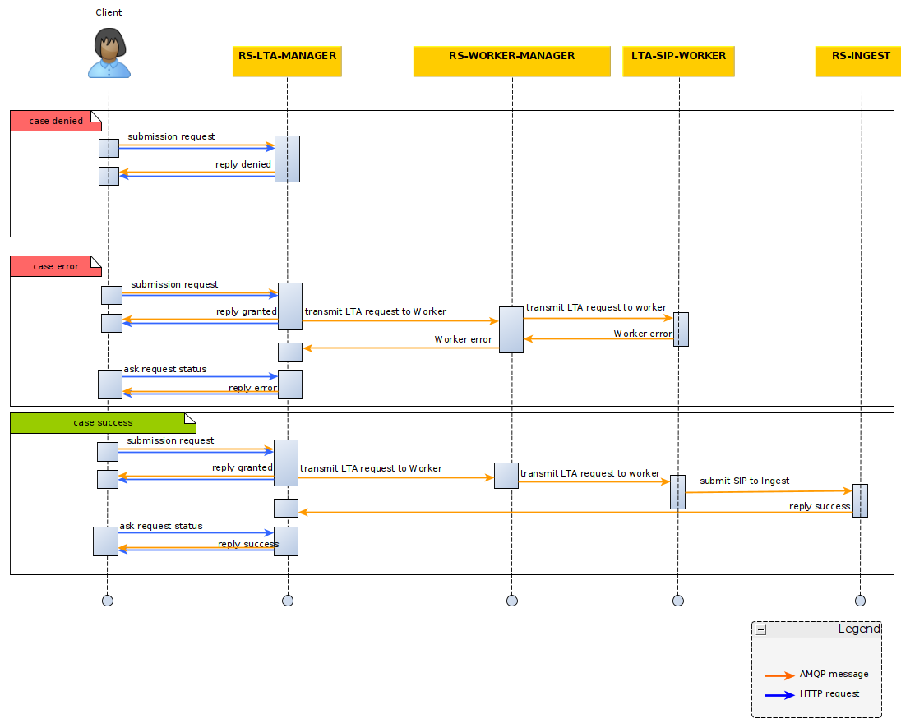

## Introduction

`LTA Manager` is used to simplify data ingestion. To do so,
LTA use a datatype configuration. It allows to associate a label (datatype name) to a configuration (
see [LTA Manager configuration](./configuration/lta-manager-import-export.md)).

The submission requests must indicate a datatype to let LTA Manager knows which configuration use.
Otherwise, the request will be denied.

The main purpose of the microservice is to transfer product creation requests to the `rs-worker-manager` service.
The product will then be transformed into a SIP and sent to the `rs-ingest` service using a
dedicated [worker](../../concepts/08-workers.md).

To learn how to submit product creation request to the `LTA Manager` microservice, please refer to
the [AMQP API Guide](./api-guides/amqp/amqp-submit-product.md)
and [REST API Guide](./api-guides/rest/rest-create-product.mdx).

LTA request are stored in database, and status requests can be followed from admin UI (Admin/LTA Manager).



:::note
We've illustrated an error on the Worker side, but you can also have an error on the Ingestion step and on the Storage
step.
:::

## Data types

Every [product](../../../overview/concepts/01-products.md) submitted to the `LTA Manager` microservice must define a *
*Data Type**.

The Data Type concept is the main concept enabling the microservice to know how to process the product creation request.

All Data Types must be configured on the service in order to define for each one :

- The [data model](../../../overview/concepts/02-meta-catalog.md) used to validate the product
- The sub-directory for storing the files associated with the product in the long-term archive.

## Versioning

Versioning of products is the same as describe in the [rs-ingest documentation](../ingest/conception.md#versioning).
Nevertheless, only two versioning methods are available with `LTA Manager`, **REPLACE** and **INC_VERSION**.

When you submit a creation request you can provide a parameter to choose the versioning mode. Please refer to
the [AMQP Guide](./api-guides/amqp/amqp-submit-product.md) and
the [Rest API Guide](./api-guides/rest/rest-create-product.mdx).

## Worker Manager configuration

The `lta-manager` service can only operate if the `worker-manager` service is properly configured.
Indeed, `lta-manager` delegates the product creation requests to `worker-manager`, which is responsible for starting the
appropriate workers.

For general instructions on how to configure the worker-manager service, refer to the
[Worker Manager configuration section](/docs/development/services/worker-manager/configuration/import_export)

This workflow involves two specific workers:

* **lta-product-zip-extraction-worker**
* **lta-sip-generator-worker**

You must therefore configure two `workerType` entries corresponding to these workers, as well as a `workflowType` that
defines their execution sequence.

```json title='rs-worker-manager configuration for lta workers example'
{
  "microservice": "rs-worker-manager",
  "modules": [
    ...
    "configuration"
    :
    [
      {
        "key": "fr.cnes.regards.modules.workermanager.dto.WorkflowConfigDto",
        "value": {
          "workflowType": "lta-request",
          "steps": [
            {
              "stepNumber": 1,
              "workerType": "lta-product-zip-extraction-worker"
            },
            {
              "stepNumber": 2,
              "workerType": "lta-sip-generator-worker"
            }
          ]
        }
      },
      {
        "key": "fr.cnes.regards.modules.workermanager.dto.WorkerConfigDto",
        "value": {
          "workerType": "lta-product-zip-extraction-worker",
          "contentTypeInputs": [
            "lta-to-extract-request"
          ],
          "contentTypeOutput": "lta-extracted-request"
        }
      },
      {
        "key": "fr.cnes.regards.modules.workermanager.dto.WorkerConfigDto",
        "value": {
          "workerType": "lta-sip-generator-worker",
          "contentTypeInputs": [
            "lta-extracted-request"
          ]
        }
      }
    ]
    }
  ]
}
```

## LTA workers

The LTA workflow uses two workers in a workflow. They receive and return an **LtaWorkerRequestDto**, which carries
the LTA
product, the configured model and storage, and the data type storage path. The `rs-worker-manager` workflow shown above
routes the output of the extraction worker to the SIP generator worker.

### lta-product-zip-extraction-worker

The `lta-product-zip-extraction-worker` prepares an archive product for ingestion in `rs-ingest`:

1. It expects exactly one input file of type **ZIP**. If a request contains no ZIP, the worker does nothing: it leaves
   the request unchanged and does not produce an error. A request containing several ZIP files, or a ZIP together with
   other input files, fails.
2. It verifies that the archive URL belongs to a configured S3 server, downloads it into an isolated workspace, and
   checks its MD5 checksum when a checksum is supplied in the request.
3. It extracts every archive entry, stores it in the configured target S3 storage and computes its checksum.
4. It assigns datatypes to each extracted file using the **lta.product-zip-extraction.extension-to-types**
   configuration.
5. It replaces the input ZIP with the extracted files. Existing non-ZIP files are retained when applicable.
6. It deletes the source ZIP from the bucket.

If one entry cannot be stored, the worker rolls back files already written to the target S3 storage. Its temporary
workspace is removed after each processing attempt.

#### File datatype selection

The worker assigns one or more REGARDS datatypes to every extracted file according to its extension. This mapping is
configured with **lta.product-zip-extraction.extension-to-types**; extension keys are written without the leading
dot and
are case-insensitive. An extension can map to several types, in which case the worker emits one file descriptor for
each configured type, all referencing the same stored object.

```yaml title="lta-product-zip-extraction-worker configuration"
lta:
  product-zip-extraction:
    extractPath: /var/regards/workspace/lta-extraction
    targetStorage:
      protocol: https
      host: minio.example.org
      port: "443"
      region: fr-regards-1
      key: <access-key>
      secret: <secret-key>
      bucket: lta-extracted-products
      rootPath: lta
    deletion:
      buckets:
        allowed: lta-input
    extension-to-types:
      jp2:
        - OTHER
        - RAWDATA
      jpg:
        - QUICKLOOK_SD
      xml:
        - RAWDATA
worker:
  tenants: tenant
```

By default:

- the worker assigns **RAWDATA** if an extension has no mapping;
- **jpg**, **jpeg** and **png** are mapped to **QUICKLOOK_SD**.

A complete external **extension-to-types** map replaces those defaults. For **QUICKLOOK_SD**,
**QUICKLOOK_MD**, **QUICKLOOK_HD** and **THUMBNAIL**, only the first extracted file assigned to a given type keeps that
type.
Subsequent candidates for the same unique type are skipped; if this leaves a file without any type, it falls back to
**RAWDATA**.

The file datatypes produced here are consumed by the `rs-ingest` chain. Configure the
[VirtualStorageLocation plugin](../ingest/plugins/overview.md) accordingly; for example, route **OTHER** to a local NFS
storage and **RAWDATA** to Datalake storage locations.

### lta-sip-generator-worker

The `lta-sip-generator-worker` converts the processed LTA request into an **IngestRequestFlowItem** and publishes it to
the `rs-ingest` AMQP exchange
`regards.broadcast.fr.cnes.regards.modules.ingest.dto.sip.flow.IngestRequestFlowItem`.

Before processing, it requires the **regards.request.id**, **regards.request.session** and
**regards.request.owner** headers. It validates each file URL: the URL must be syntactically valid, use a supported
protocol and resolve to an accessible file. HTTP proxy settings can be supplied through **proxyHost**, **proxyPort** and
**noProxyHosts**; **proxyPort** is mandatory and positive when **proxyHost** is set.

The generated SIP uses the LTA **productId** as its identifier, propagates geometry, descriptive properties, tags and
the optional origin URN. Each LTA file becomes one **ContentInformation** with its datatype, URL, MIME type, MD5
checksum
and resolved size. The output metadata contains the configured model and ingestion chain, uses **REPLACE** when the LTA
request is in replace mode and **INC_VERSION** otherwise, and always sets **replaceErrors** to **true**.

```yaml title="lta-sip-generator-worker configuration"
lta:
  sip-generator:
    ingestChain: DefaultProcessingChain
    proxyHost: proxy.example.org
    proxyPort: 8080
    noProxyHosts: rs-storage,minio.example.org
```

When the LTA request provides a storage name, the worker forwards it as an `rs-ingest` storage metadata entry. Its
**storePath** is the product **storePath** when present, otherwise the **dataTypeStorePath** provided by
`rs-lta-manager`.
The `rs-ingest` processing chain then validates the resulting SIP and applies its storage metadata rules.
