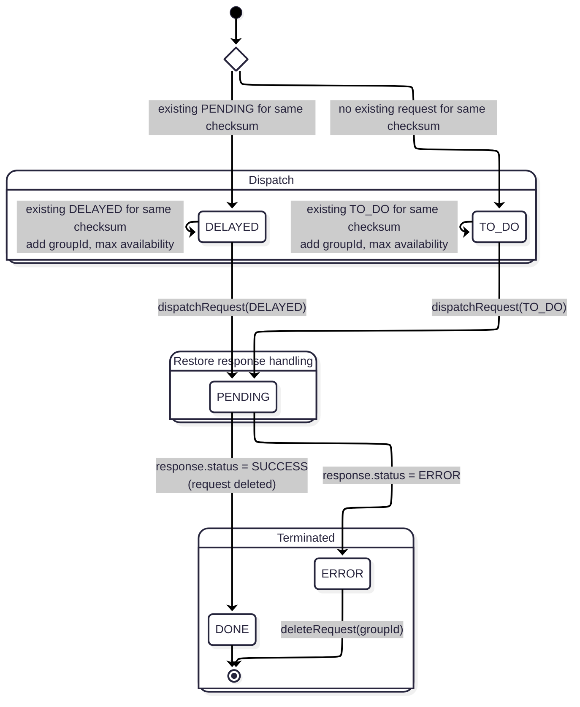
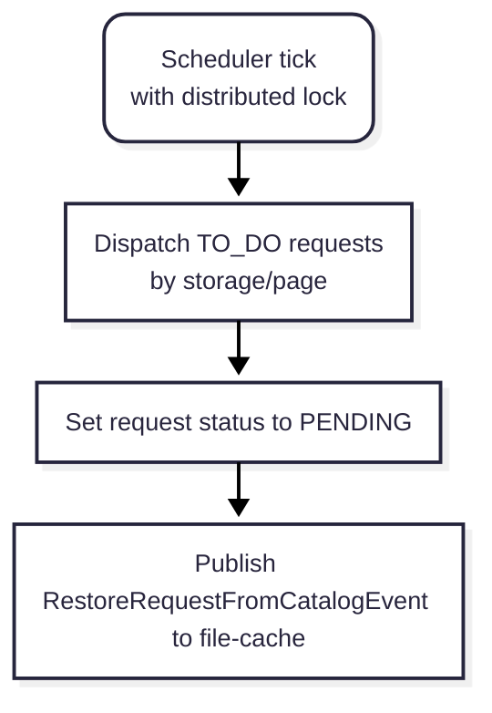
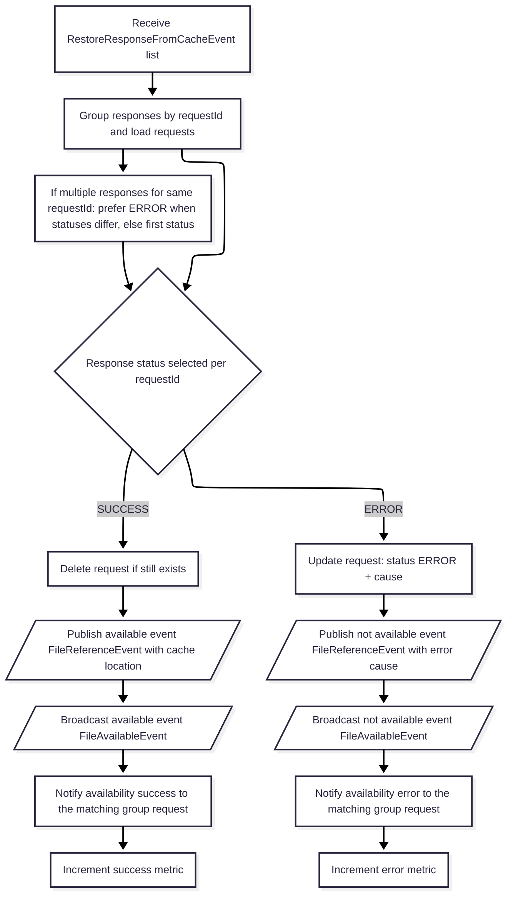
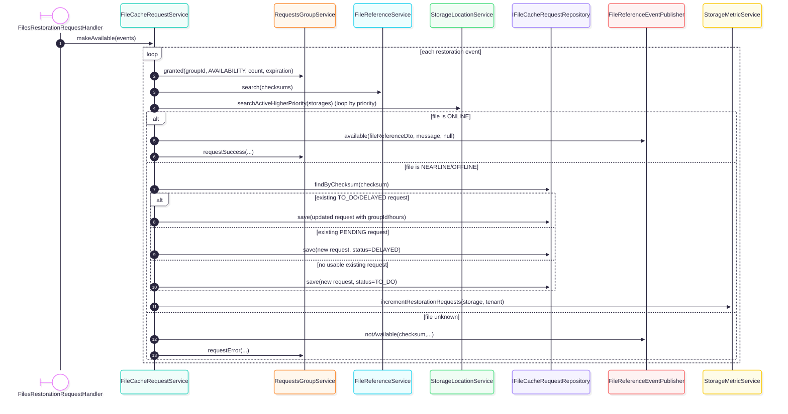
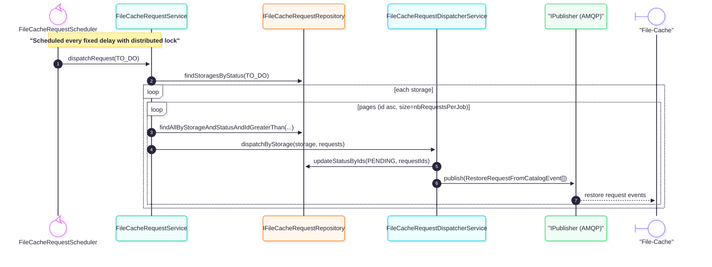
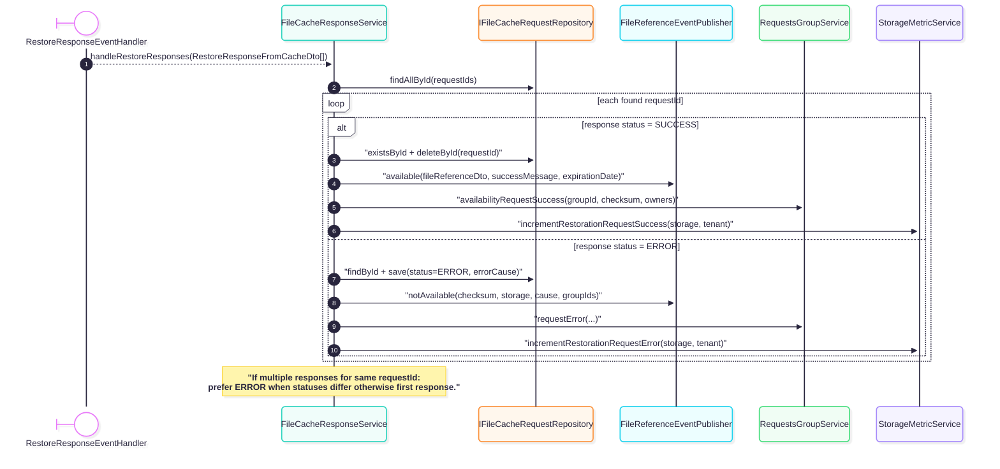

# Restoration file request

Since `file-catalog` has already the knowledge of the file location, on a file restoration request, the `file-catalog` 
service will:
- Handle restoration requests for files that are not available in online storage, coordinate with the file-cache 
service to restore files from nearline or offline storage.
- Once available, notify the requesting service of the file availability or non-availability if file cannot be restored.
- File already available in online storage will be immediately notified as available without any restoration 
  request.
- File request hold by unknown storage will be immediately notified as not available without any restoration request.
- File restoration requests are grouped by checksum to avoid multiple restoration requests for the same file. The group is identified by a unique groupId and can have multiple owners (requesting services) that will be notified of the file availability or non-availability.

## Lifecycle State Machine


## Activity Diagrams

### Restoration request handling

```mermaid
---
config:
    theme: redux-color
    look: neo
    layout: elk
---
flowchart TD
    %% Restoration request handling
    A>Receive FilesRestorationRequestEvent] --> B[Create/mark request group as granted]
    B --> C[Search FileReferences by checksums]
    C --> D[Partition by storage priority and type]

    D --> E{Storage category}
    E -->|ONLINE| Online[Generate download URL]
    Online --> Online1[/Publish available FileRequestEvent event with download location/]
    Online1 --> Online2[/Broadcast available FileAvailableEvent event/]
    Online2 --> Online3[Mark group request success]

    E -->|UNKNOWN| Unknown1[/Publish not available FileRequestEvent/]
    Unknown1 --> Unknown2[/Broadcast not available FileAvailableEvent event/]
    Unknown2 --> Unknown3[Mak group request error]
    E -->|NEARLINE or OFFLINE| Nearline[Create or update FileCacheRequest]
    
    Nearline --> Status{Existing request status?}
    Status -->|TO_DO or DELAYED exists| Update[Merge groupId and availability]
    Status -->|PENDING exists| Delayed[Create DELAYED request]
    Status -->|No matching active request| Todo[Create TO_DO request]
    Update --> Persist[Persist request]
    Delayed --> Persist
    Todo --> Persist
    Persist --> Metric[Increment restoration request metric]
```

### Dispatching restoration requests to file-cache



### Receiving restoration responses from file-cache



## Sequence Diagrams

### Reception of restoration requests



### Dispatching restoration request to file-cache:



### Reception of restoration response from file-cache:


