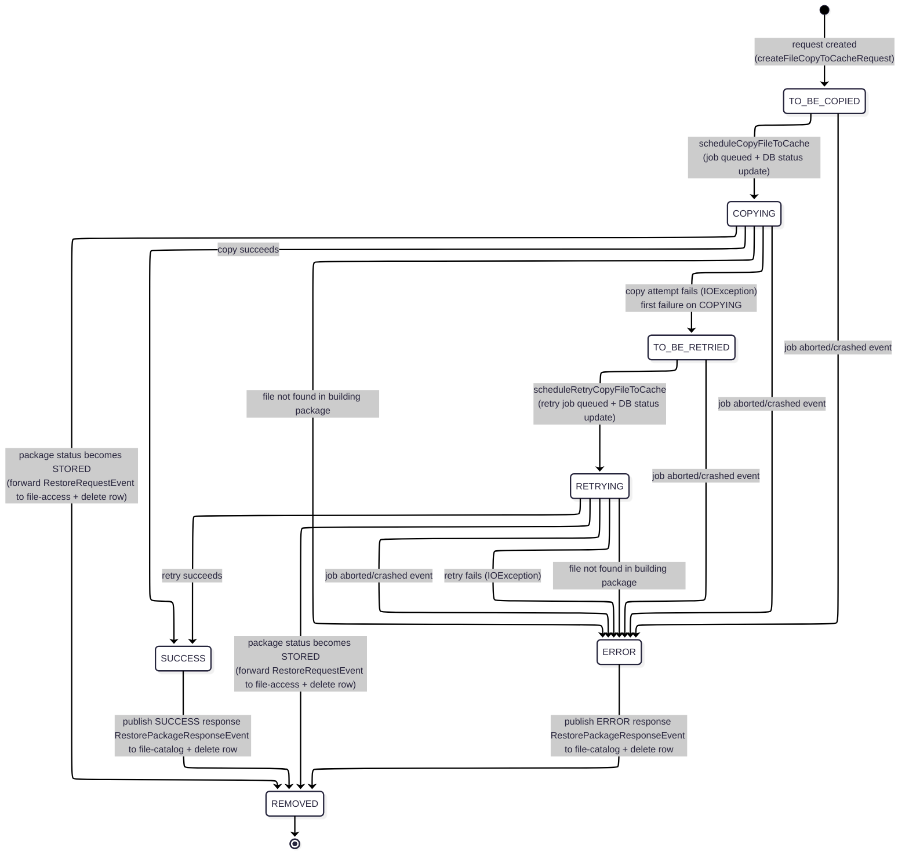
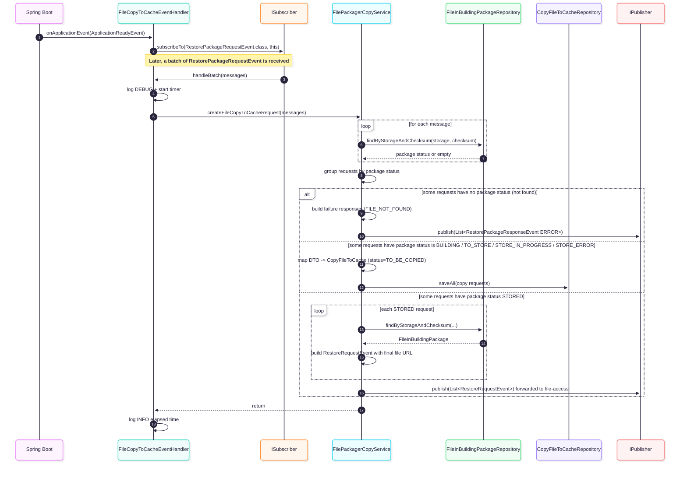
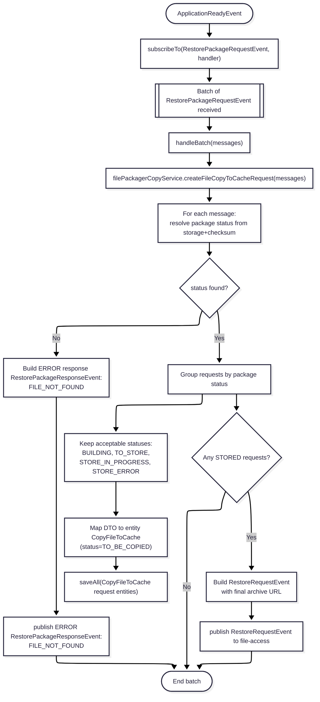
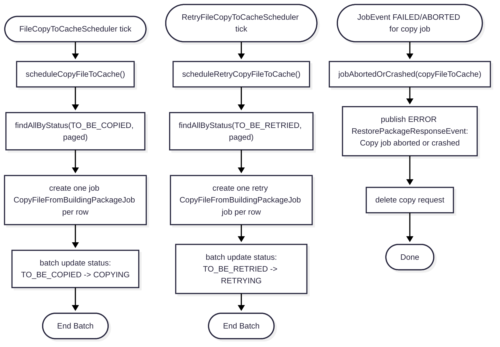
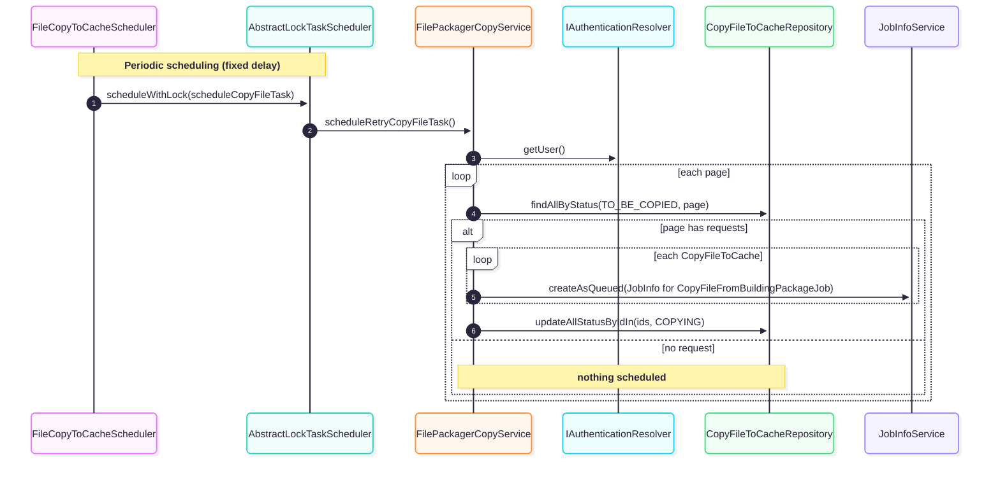
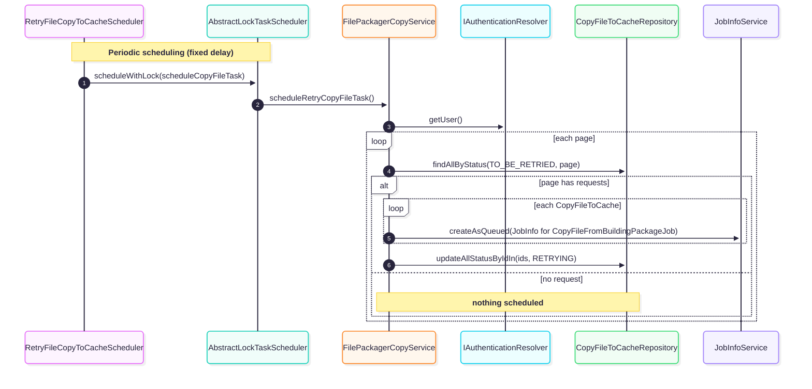
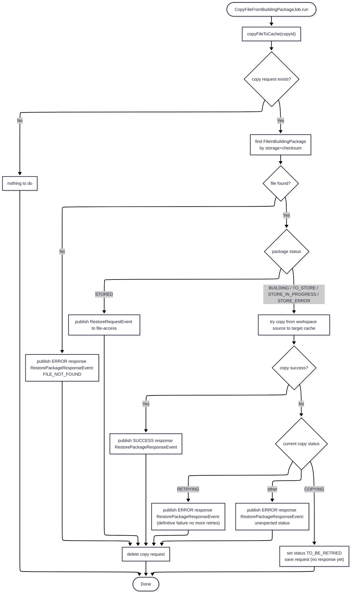
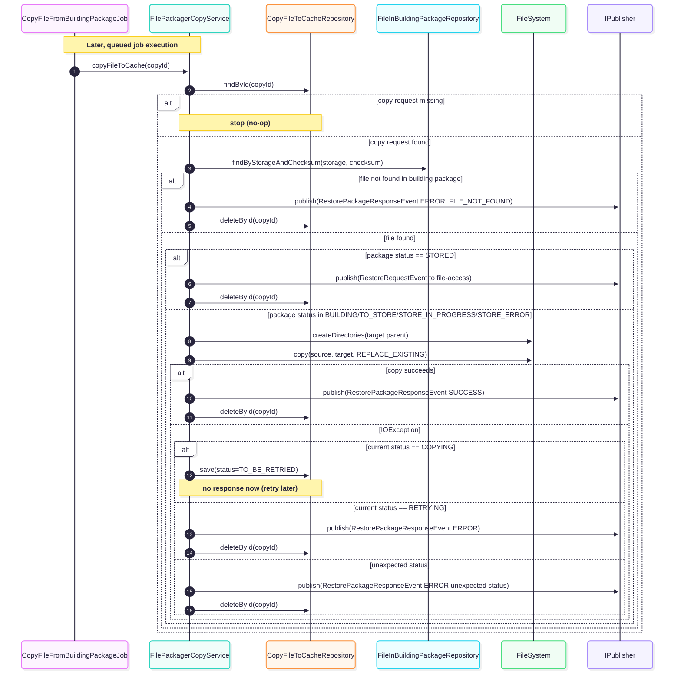

# Restoration file request

Restoration concerned only "small" files that have been aggregated into packages (also known as archive) by the 
`file-packager` microservice.

On reception of a `RestorePackageRequestEvent` from the `file-cache` microservice:
- if the package is already STORED in nearline storage, 
  the `file-packager` microservice forwards the request as a `RestoreRequestEvent` to the `file-access` 
  microservice to restore files from nearline storage to online storage only .
- if the package is not yet STORED the `file-packager` microservice persists a `CopyFileToCache` entity 
  and will try to copy the file from its own workspace to the cache 
  and publish a `RestorePackageResponseEvent` with the restoration status (ERROR or SUCCESS) to the `file-catalog` microservice.
- Copy that fails once will be retried once on next scheduling until the copy is successful or definitively failed.

## Request status of `CopyFileToCache` entity

#### Statuses of `CopyFileToCache` entity.

Note: ERROR and SUCCESS exist in CopyFileStatus, 
but in current CopyFileToCache flow the entity is typically deleted after final outcome 
rather than persisted in those statuses.

| Status         | Description                                                          |
|----------------|----------------------------------------------------------------------|
| `TO_BE_COPIED` | The copy is pending.                                                 |
| `COPYING`      | The copy is being copied.                                            |
| `TO_BE_RETRIED`| The copy failed a first time and will be retried on next scheduling. |
| `RETRYING`     | The copy is being retried.                                           |
| `ERROR`        | The copy definitively failed.                                        |
| `SUCCESS`      | The copy is successful.                                              |

#### State diagram of `CopyFileToCache` entity.

### Handling of `RestorePackageRequestEvent` events

The handler subscribes once to `RestorePackageRequestEvent` when application is ready
then on reception of that event processes batches of requests by delegating it to the `FilePackagerCopyService`.

For each request, it checks the package status and either forwards the request to `file-access` or persists a copy
request `CopyFileToCache` for later processing.

#### Sequence diagram of restoration request handling

#### Activity diagram of restoration request handling

### Scheduling copy jobs and handling job failure or abortion events

Regularly, the `FileCopyToCacheScheduler` and `RetryFileCopyToCacheScheduler` schedule `CopyFileFromBuildingPackageJob` jobs for all pending requests in the database.

- `FileCopyToCacheScheduler` schedules copy jobs for all requests with the pending status `TO_BE_COPIED`.
- `RetryFileCopyToCacheScheduler` schedules copy jobs for all requests with the pending status `TO_BE_RETRIED`.

When a job execution fails or is aborted a JobEvent is handled by the AbortedOrFailedJobEventHandler.
In the case the job is a `CopyFileFromBuildingPackageJob` job, an ERROR 
`RestorePackageResponseEvent` to notify `file-catalog` is published.

#### Activity diagrams of scheduled copy jobs and handling job failure or abortion events

#### Sequence diagram of the 'FileCopyToCacheScheduler'

#### Sequence diagram of the 'RetryFileCopyToCacheScheduler'

### Job execution of `CopyFileFromBuildingPackageJob`

Depending on the status of the package, the job either forwards the request to `file-access` or tries to copy the file from its own workspace to the cache.
If the copy fails once, the request is marked `TO_BE_RETRIED` and will be retried on next scheduling.

#### Activity diagram of the job execution `CopyFileFromBuildingPackageJob`

#### Sequence diagram of the job execution of `CopyFileFromBuildingPackageJob`

